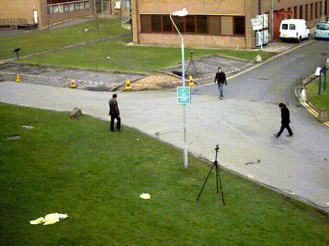

# video-infer

Real-time, multi-stream person detection in C++17 with ONNX Runtime and OpenCV, built step by step toward edge deployment on a Raspberry Pi.

The whole pipeline — letterbox preprocessing, ONNX Runtime inference, YOLO output decoding, IoU / NMS, a lightweight tracker, and drawing — is implemented by hand in C++ and was verified stage by stage against a Python reference.

**Result:** 4 simultaneous 10 FPS streams processed in real time on 4 CPU cores, with ~0.07% dropped frames and ~57 ms average capture-to-result latency.



*Green: detected in this frame. Yellow: position predicted by the tracker while the detector missed the person (e.g. behind the sign or the lamp post).*

## Features

- **Hand-written YOLO11n pipeline in C++**: letterbox resize, HWC→CHW, ONNX Runtime C++ API, decoding of the `[1, 84, N]` output, IoU and NMS
- **Model-agnostic input size**: input resolution and number of candidate boxes are read from the model, so 320 / 416 / 480 / 640 models run without code changes
- **Person-only detection** for the surveillance use case (reads the person score directly instead of scanning all 80 classes)
- **Real-time producer–consumer pipeline**: one capture thread per stream simulates a camera at the video's native FPS; a bounded, thread-safe `FrameQueue` drops the oldest frame when full to keep latency bounded
- **Multi-stream** processing with `std::thread`, sharing a single ONNX Runtime session
- **IoU tracker with constant-velocity prediction** for temporal smoothing: bridges short detector misses and occlusions, and suppresses one-frame false positives
- Reports **latency, drop rate and throughput** per stream
- **Fault isolation**: exceptions are caught inside each worker thread, so one failing stream does not take down the others

## Project structure

```
src/
├── common.hpp         shared types (Detection, Frame, Timing, Letterbox), clock helpers, constants
├── frame_queue.hpp    bounded thread-safe queue (mutex + condition_variable)
├── detector.hpp/.cpp  letterbox preprocessing, ONNX Runtime inference, decode, IoU, NMS
├── tracker.hpp/.cpp   IoU tracker with constant-velocity prediction
├── draw.hpp/.cpp      drawing detections and tracks
├── pipeline.hpp/.cpp  capture thread (producer) and inference thread (consumer)
└── main.cpp           argument parsing, session setup, thread launch, report
```

## Architecture

```
                 ┌──────────────────────────── per stream ────────────────────────────┐
 video / camera  │  capture thread          FrameQueue          inference thread
 ──────────────► │  read at native FPS ──►  [■]  ──►  letterbox → ONNX Runtime → decode
                 │  timestamp + clone       bounded,  → NMS → map to original coords
                 │                          drop oldest → tracker → draw → write
                 └─────────────────────────────────────────────────────────────────────┘
                                     shared Ort::Session (thread-safe Run)
```

- `FrameQueue` wraps `std::queue`, `std::mutex` and `std::condition_variable`; `pop()` blocks until a frame arrives or the producer calls `close()`.
- Latency is measured from the moment a frame is captured to the moment its result is written.
- The tracker matches tracks to detections by IoU after predicting each track forward with a smoothed velocity; a track is shown after 3 hits and dropped after 5 consecutive misses.

## Build

Requirements: Ubuntu 24.04, CMake ≥ 3.16, a C++17 compiler.

```bash
# OpenCV
sudo apt install -y libopencv-dev

# ONNX Runtime (prebuilt C++ library)
wget https://github.com/microsoft/onnxruntime/releases/download/v1.20.1/onnxruntime-linux-x64-1.20.1.tgz
tar xzf onnxruntime-linux-x64-1.20.1.tgz

# Export models (Python, one time; input size must be a multiple of 32)
python3 -m venv .venv && source .venv/bin/activate
pip install ultralytics onnx
mkdir -p models
yolo export model=yolo11n.pt format=onnx imgsz=416 && mv yolo11n.onnx models/yolo11n_416.onnx

# Build (defaults to Release, i.e. -O3)
cmake -S . -B build
cmake --build build
```

The build type defaults to `Release`. Building without optimization makes the hand-written preprocessing about 2.3× slower (4.5 ms → 2.0 ms per frame at 416×416); ONNX Runtime itself is a prebuilt, optimized library and is unaffected.

## Usage

```bash
./build/video_infer <model.onnx> <video> [num_streams] [intra_threads] [queue_size]

# 4 streams, 1 ONNX Runtime thread per inference, queue size 1
./build/video_infer models/yolo11n_416.onnx videos/vtest.avi 4 1 1
```

| Argument | Default | Meaning |
|---|---|---|
| `num_streams` | 1 | number of simulated camera streams |
| `intra_threads` | ONNX Runtime default | threads used inside one inference |
| `queue_size` | 3 | max frames buffered per stream |

## Benchmarks

**Environment:** AMD Ryzen 5 5600H (6C/12T) · VirtualBox VM with 4 vCPUs and 8 GB RAM · Ubuntu 24.04 · YOLO11n FP32 · OpenCV sample video `vtest.avi` (768×576, 10 FPS, 795 frames).

Numbers inside a VM depend heavily on host load. The final result below is the median of 3 runs with other host programs closed; the earlier tables were measured in noisier sessions and with an unoptimized build (which affects preprocessing and postprocessing, not ONNX Runtime inference), so compare trends within a table rather than absolute values across tables.

### Final configuration (v1.0)

416×416 input · letterbox · person only · tracker · 4 streams × 1 intra-op thread · queue size 1 · camera simulated at 10 FPS

| Metric | Value (median of 3 runs) |
|---|---|
| Inference / frame | 44.5 ms |
| Capture-to-result latency | 56.9 ms |
| Processed FPS / stream | ≈ 9.99 (input: 10) |
| Dropped frames | ≈ 0.07% (2–3 of 3180) |

### Input resolution (4 streams, real-time 10 FPS input)

| Input size | Inference / frame | Drop rate | Avg latency |
|---|---|---|---|
| 320 | 28 ms | 0.2% | 40 ms |
| **416** | **64 ms** | **1%** | **90 ms** |
| 480 | 104 ms | 24% | 162 ms |
| 640 | 212 ms | 60% | 293 ms |

Each frame has a 100 ms budget at 10 FPS. Once processing exceeds it (480 and above), the drop rate jumps sharply rather than growing gradually. 416 is the largest input that stays within budget, keeping more detail than 320, where small people flicker in and out. Going from 640 to 320 sped inference up 7.5× — more than the 4× reduction in pixels — because the CPU was no longer saturated and the smaller activations fit better in cache.

### Streams × intra-op threads (640 input, offline, as fast as possible)

| Streams × threads per inference | Total FPS | Inference / frame |
|---|---|---|
| 1 × 4 (default) | 11.4 | 59 ms |
| 4 × 4 (default) | 14.1 | 198 ms |
| 1 × 1 | 8.4 | 96 ms |
| **4 × 1** | **17.1** | 195 ms |

With ONNX Runtime's default thread count, 4 streams oversubscribe the 4 vCPUs (≈16 busy threads). Limiting each inference to 1 thread raises total throughput by 21%, but per-stream inference still slows from 96 to 195 ms because of shared resources (memory bandwidth, L3 cache, SMT siblings).

### Queue size (640 input, real-time 10 FPS input, 1 thread per inference)

| Streams | Queue size | Drop rate | Avg latency |
|---|---|---|---|
| 1 | 3 | 27% | 384 ms |
| 1 | 1 | 25% | 171 ms |
| 4 | 3 | 63% | 514 ms |
| 4 | 1 | 63% | 311 ms |

When inference cannot keep up, the drop rate is set by processing speed, not queue size. A shorter queue only reduces how long the processed frame waited (latency ≈ queue length × processing time).

## Known limitations

- **Crowded scenes**: when two people overlap heavily, NMS can treat their boxes as duplicates and keep only one.
- **Occlusion**: partially hidden people fall below the confidence threshold. The tracker bridges short gaps (up to 5 frames) but not long ones.
- **No identity tracking**: the tracker uses position only, so a person passing behind a pole often gets a new track (ID switch). Track IDs are therefore not displayed; the tracker is used for temporal smoothing. Stable identities would need appearance features (e.g. DeepSORT) or a stronger association method (e.g. ByteTrack with a Kalman filter).
- When a stream's inference thread fails, its capture thread keeps decoding until the video ends; a stop signal from consumer to producer would avoid the wasted work.
- Preprocessing (~2 ms per frame at 416×416 in a Release build) is about 5% of the frame time, so it was left as a straightforward loop rather than optimized further.

## Roadmap

- [x] v0.1 — single-image detection in C++, verified against Python
- [x] v0.2 — video inference with per-stage timing
- [x] v0.3 — multi-stream threads and real-time producer–consumer pipeline
- [x] v1.0 — resolution study, letterbox, person-only filter, IoU tracker with velocity prediction
- [x] v1.1 — split into modules, exception handling in worker threads, Release build by default
- [ ] v1.2 (optional) — rectangular model input (e.g. 320×416 for 4:3 video), ByteTrack comparison
- [ ] v2 — deployment on Raspberry Pi 3B+ (ARM, 1 GB RAM), INT8 quantization

## Model

YOLO11n pretrained on COCO, from [Ultralytics](https://github.com/ultralytics/ultralytics) (AGPL-3.0), exported to ONNX.