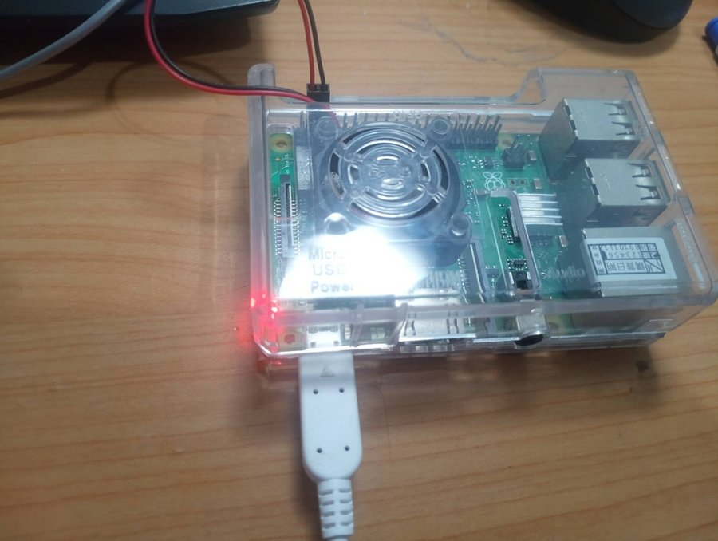
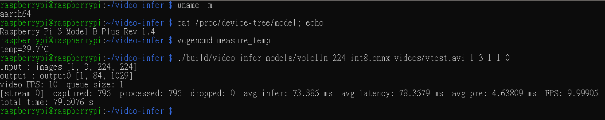

# video-infer

Real-time person detection in C++17 with ONNX Runtime and OpenCV, built step by step from a single-image prototype to multi-stream processing on a PC and real-time INT8 inference on a Raspberry Pi 3B+.

The whole pipeline — letterbox preprocessing, ONNX Runtime inference, YOLO output decoding, IoU / NMS, a lightweight tracker, and drawing — is implemented by hand in C++ and was verified stage by stage against a Python reference.

**Results**

- **PC (4 vCPUs):** 4 simultaneous 10 FPS streams in real time, ~0.07% dropped frames, ~57 ms average capture-to-result latency.
- **Raspberry Pi 3B+ (4× Cortex-A53, 1 GB RAM):** one 10 FPS stream in real time with **detection on every frame, 0 dropped frames and 78 ms latency**, up from 2.8 FPS in the first deployment. INT8 quantization made inference 2.1× faster at a cost of 0.7 points of person mAP50 on COCO (0.497 → 0.490).


## Features

- **Hand-written YOLO11n pipeline in C++**: letterbox resize, HWC→CHW, ONNX Runtime C++ API, decoding of the `[1, 84, N]` output, IoU and NMS
- **Model-agnostic input size**: input resolution and number of candidate boxes are read from the model, so 192–640 FP32 and INT8 models run without code changes
- **INT8 static quantization** (`tools/quantize.py`) with the detection-head decode kept in FP32, validated on COCO val2017
- **Person-only detection** for the surveillance use case (reads the person score directly instead of scanning all 80 classes)
- **Real-time producer–consumer pipeline**: one capture thread per stream simulates a camera at the video's native FPS; a bounded, thread-safe `FrameQueue` drops the oldest frame when full to keep latency bounded
- **Multi-stream** processing with `std::thread`, sharing a single ONNX Runtime session
- **IoU tracker** for temporal smoothing: suppresses one-frame false positives and keeps tracks alive through short detector misses
- **Keyframe detection** (optional): run the detector every N frames and reuse the last confirmed boxes in between
- **Optional video output**: drawing and encoding can be turned off, as on a real edge device that only reports detections
- Reports **latency, drop rate and throughput** per stream
- **Fault isolation**: exceptions are caught inside each worker thread, so one failing stream does not take down the others
- **Cross-platform build**: the same CMake project builds on x86-64 and on the Raspberry Pi (aarch64)

## Project structure

```
src/
├── common.hpp         shared types (Detection, Frame, Timing, Letterbox), clock helpers, constants
├── frame_queue.hpp    bounded thread-safe queue (mutex + condition_variable)
├── detector.hpp/.cpp  letterbox preprocessing, ONNX Runtime inference, decode, IoU, NMS
├── tracker.hpp/.cpp   IoU tracker
├── draw.hpp/.cpp      drawing detections and tracks
├── pipeline.hpp/.cpp  capture thread (producer) and inference thread (consumer)
└── main.cpp           argument parsing, session setup, thread launch, report
tools/
└── quantize.py        INT8 static quantization with ONNX Runtime
```

## Architecture

```
                 ┌──────────────────────────── per stream ────────────────────────────┐
 video / camera  │  capture thread          FrameQueue          inference thread
 ──────────────► │  read at native FPS ──►  [■]  ──►  every N frames:
                 │  timestamp + clone       bounded,    letterbox → ONNX Runtime → decode
                 │                          drop oldest → NMS → map to original coords → tracker
                 │                                      every frame (optional): draw → write
                 └─────────────────────────────────────────────────────────────────────┘
                                     shared Ort::Session (thread-safe Run)
```

- `FrameQueue` wraps `std::deque`, `std::mutex` and `std::condition_variable`; `pop()` blocks until a frame arrives or the producer calls `close()`.
- Preprocessing writes straight into the input tensor: three single-channel `cv::Mat` headers point into the tensor buffer, `cv::split` fills them, and the BGR→RGB swap is done by choosing which plane each channel is written to.
- Latency is measured from the moment a frame is captured to the moment the inference thread finishes with it.
- The tracker matches tracks to detections by IoU; a track is shown after 3 hits and dropped after 5 consecutive misses. Only tracks matched in the latest detection are drawn.

## Build

Requirements: Ubuntu 24.04 or Raspberry Pi OS / Debian (64-bit), CMake ≥ 3.16, a C++17 compiler.

```bash
# OpenCV
sudo apt install -y libopencv-dev

# ONNX Runtime (prebuilt C++ library)
# x86-64:
wget https://github.com/microsoft/onnxruntime/releases/download/v1.20.1/onnxruntime-linux-x64-1.20.1.tgz
# Raspberry Pi (aarch64), extracted to ~/video-infer-deps/:
wget https://github.com/microsoft/onnxruntime/releases/download/v1.20.1/onnxruntime-linux-aarch64-1.20.1.tgz

# Build (defaults to Release, i.e. -O3)
cmake -S . -B build
cmake --build build          # on the Raspberry Pi: cmake --build build -j1 (1 GB RAM)
```

`CMakeLists.txt` picks the ONNX Runtime folder from the CPU architecture, so the same project builds on both machines.

### Models (on a PC, one time)

```bash
python3 -m venv .venv && source .venv/bin/activate
pip install ultralytics onnx onnxruntime==1.20.1 opencv-python
mkdir -p models

# FP32 export (input size must be a multiple of 32)
yolo export model=yolo11n.pt format=onnx imgsz=224 && mv yolo11n.onnx models/yolo11n_224.onnx

# INT8: calibration images (COCO128, not used for evaluation), graph preprocessing, quantization
mkdir -p calib && cd calib
wget https://github.com/ultralytics/assets/releases/download/v0.0.0/coco128.zip && unzip -q coco128.zip && cd ..
python -m onnxruntime.quantization.preprocess --input models/yolo11n_224.onnx --output models/yolo11n_224_prep.onnx
python tools/quantize.py 224          # → models/yolo11n_224_int8.onnx (11 MB → 3 MB)

# Copy to the Raspberry Pi
scp models/yolo11n_224_int8.onnx <user>@<pi-address>:~/video-infer/models/
```

## Usage

```bash
./build/video_infer <model.onnx> <video> [num_streams] [intra_threads] [queue_size] [detect_every] [write_video]

# PC: 4 streams, 1 ONNX Runtime thread each, queue size 1
./build/video_infer models/yolo11n_416.onnx videos/vtest.avi 4 1 1

# Raspberry Pi: 1 stream, 3 threads, detect on every frame, no video output
./build/video_infer models/yolo11n_224_int8.onnx videos/vtest.avi 1 3 1 1 0
```

| Argument | Default | Meaning |
|---|---|---|
| `num_streams` | 1 | number of simulated camera streams |
| `intra_threads` | ONNX Runtime default | threads used inside one inference |
| `queue_size` | 3 | max frames buffered per stream |
| `detect_every` | 1 | run the detector every N frames, reuse the last boxes in between |
| `write_video` | 1 | `0` skips drawing and writing `result_<i>.avi` |

## Accuracy (COCO val2017, person class)

Evaluated with `yolo val ... data=coco.yaml classes=0` on all 5000 images (10,777 people). Accuracy does not depend on the hardware, so it was measured on the PC.

| Model | Precision | Recall | mAP50 | mAP50-95 | AP small | AP medium | AP large |
|---|---|---|---|---|---|---|---|
| 640 FP32 | 0.817 | 0.646 | 0.751 | 0.518 | 0.210 | 0.430 | 0.570 |
| 480 FP32 | 0.797 | 0.607 | 0.704 | 0.474 | 0.146 | 0.394 | 0.573 |
| 416 FP32 | 0.786 | 0.578 | 0.671 | 0.447 | 0.125 | 0.361 | 0.563 |
| 320 FP32 | 0.762 | 0.521 | 0.605 | 0.393 | 0.083 | 0.300 | 0.532 |
| 224 FP32 | 0.710 | 0.427 | 0.497 | 0.309 | 0.036 | 0.190 | 0.447 |
| 224 INT8, whole model quantized | 0.977 | 0.209 | 0.200 | 0.139 | 0.001 | 0.048 | 0.231 |
| **224 INT8, head decode in FP32** | **0.700** | **0.422** | **0.490** | **0.302** | 0.034 | 0.185 | 0.435 |

- **Smaller inputs mainly lose small people.** From 640 to 224, AP for large people drops from 0.57 to 0.45, but for small people from 0.21 to 0.04. 224 suits a camera close to the scene (a doorway or corridor); a wide view with distant people needs 320 or more.
- **Quantizing the whole model broke it.** The output tensor concatenates box coordinates (0–224 px) and class scores (0–1), so both share one INT8 scale of about 224 / 255 ≈ 0.88. Every score is rounded to either 0 or 0.88: people below ~0.44 vanish and the rest look highly confident, which explains precision 0.98 with recall 0.21. Keeping the 24 decode nodes of the detection head (DFL, Sigmoid, Concat, …) in FP32, while still quantizing its convolutions, brings accuracy back to within 0.7 points of FP32 with no measurable speed cost.

## Benchmarks: PC

**Environment:** AMD Ryzen 5 5600H (6C/12T) · VirtualBox VM with 4 vCPUs and 8 GB RAM · Ubuntu 24.04 · YOLO11n FP32 · OpenCV sample video `vtest.avi` (768×576, 10 FPS, 795 frames).

Numbers inside a VM depend heavily on host load. The final result below is the median of 3 runs with other host programs closed; the earlier tables were measured in noisier sessions and with an unoptimized build (which affects preprocessing and postprocessing, not ONNX Runtime inference), so compare trends within a table rather than absolute values across tables.

### Final configuration (v1.0)

416×416 input · letterbox · person only · tracker · 4 streams × 1 intra-op thread · queue size 1 · camera simulated at 10 FPS

| Metric | Value (median of 3 runs) |
|---|---|
| Inference / frame | 44.5 ms |
| Capture-to-result latency | 56.9 ms |
| Processed FPS / stream | ≈ 9.99 (input: 10) |
| Dropped frames | ≈ 0.07% (2–3 of 3180) |

### Input resolution (4 streams, real-time 10 FPS input)

| Input size | Inference / frame | Drop rate | Avg latency |
|---|---|---|---|
| 320 | 28 ms | 0.2% | 40 ms |
| **416** | **64 ms** | **1%** | **90 ms** |
| 480 | 104 ms | 24% | 162 ms |
| 640 | 212 ms | 60% | 293 ms |

Each frame has a 100 ms budget at 10 FPS. Once processing exceeds it (480 and above), the drop rate jumps sharply rather than growing gradually. 416 is the largest input that stays within budget. Going from 640 to 320 sped inference up 7.5× — more than the 4× reduction in pixels — because the CPU was no longer saturated and the smaller activations fit better in cache.

### Streams × intra-op threads (640 input, offline, as fast as possible)

| Streams × threads per inference | Total FPS | Inference / frame |
|---|---|---|
| 1 × 4 (default) | 11.4 | 59 ms |
| 4 × 4 (default) | 14.1 | 198 ms |
| 1 × 1 | 8.4 | 96 ms |
| **4 × 1** | **17.1** | 195 ms |

With ONNX Runtime's default thread count, 4 streams oversubscribe the 4 vCPUs (≈16 busy threads). Limiting each inference to 1 thread raises total throughput by 21%, but per-stream inference still slows from 96 to 195 ms because of shared resources (memory bandwidth, L3 cache, SMT siblings).

### Queue size (640 input, real-time 10 FPS input, 1 thread per inference)

| Streams | Queue size | Drop rate | Avg latency |
|---|---|---|---|
| 1 | 3 | 27% | 384 ms |
| 1 | 1 | 25% | 171 ms |
| 4 | 3 | 63% | 514 ms |
| 4 | 1 | 63% | 311 ms |

When inference cannot keep up, the drop rate is set by processing speed, not queue size. A shorter queue only reduces how long the processed frame waited (latency ≈ queue length × processing time).

### Keyframe detection (416, 4 streams, queue size 1)

| Detect every | Inference (detected frames) | Avg latency (all frames) | Drop rate |
|---|---|---|---|
| 1 | 73 ms | 95 ms | ≈ 1.5% |
| 2 | ≈ 61 ms | ≈ 42 ms | ≈ 0.03% |
| 3 | ≈ 62 ms | ≈ 31 ms | ≈ 0.06% |

Average latency drops below the inference time because reused frames finish in a few milliseconds. This average hides the fact that boxes on reused frames are up to (N−1) frames old, i.e. up to 100 ms at N = 2 and 200 ms at N = 3; both numbers are needed to describe the system.

## Benchmarks: Raspberry Pi 3B+

**Environment:** Raspberry Pi 3B+ (4× Cortex-A53 @ 1.4 GHz, 1 GB RAM) · Raspberry Pi OS 64-bit (Debian 13) · ONNX Runtime 1.20.1 aarch64 · YOLO11n · same video, 1 stream, queue size 1 · SoC temperature below 60 °C (no thermal throttling).

<p>
  
</p>



### Final configuration (v2.1)

224×224 INT8 · 3 intra-op threads · detection on every frame · no video output

| Metric | Value |
|---|---|
| Inference | 73 ms |
| Preprocessing | 4.6 ms |
| Processed FPS | 9.999 (input: 10) |
| Dropped frames | 0 of 795 |
| Avg capture-to-result latency | 78 ms |
| Person mAP50 (COCO) | 0.490 (FP32: 0.497) |

### Progress

| Version | Setting | Processed FPS | Drop rate | Detection on |
|---|---|---|---|---|
| first deployment | 320 FP32, 4 threads, video output | 2.8 | 71% | every processed frame |
| v2.0 | 224 FP32, 3 threads, no video output | 9.97 | 0.25% | every 2nd frame |
| **v2.1** | **224 INT8, 3 threads, no video output** | **10.0** | **0%** | **every frame** |

### Step 1: the first deployment (FP32, detection on every frame, with video output)

| Input | Threads | Inference | Processed FPS | Drop rate | Avg latency |
|---|---|---|---|---|---|
| 320 | 1 | 576 ms | 1.5 | 84% | — |
| 320 | 2 | 338 ms | 2.4 | 75% | — |
| 320 | 4 | 279 ms | 2.8 | 71% | 403 ms |
| 256 | 4 | 177 ms | 4.2 | 58% | 288 ms |
| 224 | 4 | 146 ms | 4.9 | 51% | 259 ms |
| 192 | 4 | 109 ms | 6.1 | 39% | 212 ms |

Inference is 10× slower than on the PC. Even at 192, a single detection does not fit in the 100 ms frame budget.

### Step 2: keyframe detection (FP32, with video output)

| Input | Detect every | Inference | Processed FPS | Drop rate |
|---|---|---|---|---|
| 256 | 2 | 176 ms | 6.6 | 33% |
| 224 | 2 | 143 ms | 7.9 | 21% |
| 256 | 3 | 174 ms | 7.4 | 25% |

Detecting every 2nd frame gives each detection a 200 ms budget. 224 needs only ~157 ms, yet it still dropped 21%: something other than inference was taking the remaining time.

### Step 3: finding the bottleneck (224 FP32, detect every 2)

| Change | Drop rate | Processed FPS | Conclusion |
|---|---|---|---|
| baseline (4 threads, video output) | 21% | 7.9 | |
| 3 instead of 4 ONNX Runtime threads | 21% | 7.8 | no gain here; at 224 the 4th thread gives no speed-up (143 vs 144 ms) |
| desktop (GUI) turned off | 23% | 7.7 | not memory; the idle desktop uses RAM, not CPU |
| **video output turned off** | **0.25%** | **9.97** | **encoding 768×576 MJPG on every frame was the bottleneck** |

On the PC, writing the output video is cheap and never showed up. On the Pi it costs enough per frame to break the budget, and it runs on every frame, including the reused ones. An edge device normally sends detection results rather than re-encoded video, so video output became optional. Moving it to a separate thread was rejected: the Pi's CPU is already fully used, so the work would only move to another core.

### Step 4: INT8 quantization (224, 4 threads, detection on every frame, no video output)

| | PC inference | Pi inference | Pi drop rate | Pi FPS |
|---|---|---|---|---|
| FP32 | 7.9 ms | 152 ms | 39% | 6.0 |
| INT8 | 20.3 ms (2.6× **slower**) | **69 ms (2.2× faster)** | 2.8% | 9.7 |

The same INT8 model is slower on the PC and faster on the Pi:

- In the quantized graph only the convolutions run in INT8. Almost every convolution is followed by SiLU (`Sigmoid` + `Mul`), which stays in FP32, so activations are converted back and forth at every layer (332 `QuantizeLinear` and 510 `DequantizeLinear` nodes for 88 `Conv`).
- On the Ryzen, FP32 is already fast (AVX2 + FMA, large caches) and the CPU has no VNNI instructions for INT8 dot products, so the saved compute does not pay for the conversions.
- On the Cortex-A53, FP32 is limited by compute and by very low memory bandwidth. INT8 moves 4× less data and packs 4× more values into each NEON register, which outweighs the conversion cost even without the ARMv8.2 dot-product instructions.

Larger inputs gained about the same: 256 went from 177 to 92 ms (1.9×) and 320 from 279 to 140 ms (2.0×). These two were measured with the first, fully quantized models; their accuracy was not re-validated after the head fix.

### Step 5: preprocessing becomes the next bottleneck

With inference halved, preprocessing was a larger share of each frame: 19 ms at 256 put the total at 111 ms, over the 100 ms budget. The per-pixel HWC→CHW loop (which read the image with a stride of 3, three times over) was replaced by `cv::split` into `cv::Mat` headers that point directly into the input tensor, and `cvtColor` was removed by writing the B and R channels into swapped planes.

| Input | PC before → after | Pi before → after |
|---|---|---|
| 224 | 1.46 → 0.6 ms | 14 → 4.9 ms |
| 256 | — | 19 → 6.3 ms |
| 320 | — | 30 → 9.5 ms |

On the PC this saved under 1 ms and looked unnecessary; on the Pi it saved 9–20 ms per frame and halved the drop rate at 256 (10% → 4.8%).

### Step 6: leaving a core for the capture thread (INT8, detection on every frame, no video output)

| Input | 4 threads | 3 threads |
|---|---|---|
| 224 | 70 ms, 2.9% dropped | 73 ms, **0% dropped** |
| 256 | 91 ms, 4.8% dropped | 95 ms, 1.6% dropped |

At 224, inference plus preprocessing needs only ~75 ms, yet 2.9% of frames were dropped. With 4 ONNX Runtime threads on 4 cores, the capture thread decoding 768×576 video had to compete for CPU. Giving ONNX Runtime 3 threads costs 3 ms of inference but lets capture run on its own core, and the drops disappear.

### Lessons

- **Measure before optimizing, on the target hardware.** Video encoding, preprocessing and thread placement each cost little on the PC and became bottlenecks on the Pi. INT8 was slower on the PC and 2.2× faster on the Pi.
- **Fixing one bottleneck exposes the next**: video output → inference → preprocessing → CPU contention with the capture thread.
- **Speed without an accuracy check is meaningless.** The first INT8 model looked fine in benchmarks but had lost half its recall; only a COCO evaluation showed it, and the cause was a shared quantization scale between box coordinates and class scores.
- **Averages can hide what matters**: with keyframes, average latency improves but boxes on reused frames are older; a single mAP number hides that small inputs mainly lose small people.

## Known limitations

- **Small, distant people**: at 224 the detector finds only ~7% of small people (COCO AR small 0.066), so the Pi configuration suits close-range cameras.
- **Crowded scenes**: when two people overlap heavily, NMS can treat their boxes as duplicates and keep only one.
- **Occlusion**: partially hidden people fall below the confidence threshold. The tracker bridges short gaps but not long ones.
- **No identity tracking**: the tracker uses position only, so a person passing behind a pole often gets a new track (ID switch). Track IDs are therefore not displayed; stable identities would need appearance features (e.g. DeepSORT) or a stronger association method (e.g. ByteTrack with a Kalman filter).
- **Keyframe detection** keeps boxes fixed between detections, so on fast motion they lag by up to (N−1) frames. Predicting positions with the tracker's velocity was tried and looked worse, so it is not used.
- When a stream's inference thread fails, its capture thread keeps decoding until the video ends; a stop signal from consumer to producer would avoid the wasted work.

## Roadmap

- [x] v0.1 — single-image detection in C++, verified against Python
- [x] v0.2 — video inference with per-stage timing
- [x] v0.3 — multi-stream threads and real-time producer–consumer pipeline
- [x] v1.0 — resolution study, letterbox, person-only filter, IoU tracker
- [x] v1.1 — split into modules, exception handling in worker threads, Release build by default
- [x] v2.0 — deployment on Raspberry Pi 3B+, keyframe detection, bottleneck analysis, optional video output
- [x] v2.1 — INT8 quantization validated on COCO, faster preprocessing, real-time detection on every frame on the Pi
- [ ] re-validate 256 / 320 INT8 with the head fix, for wider camera views
- [ ] rectangular model input (e.g. 224×288 for 4:3 video), ByteTrack comparison

## Model

YOLO11n pretrained on COCO, from [Ultralytics](https://github.com/ultralytics/ultralytics) (AGPL-3.0), exported to ONNX.
